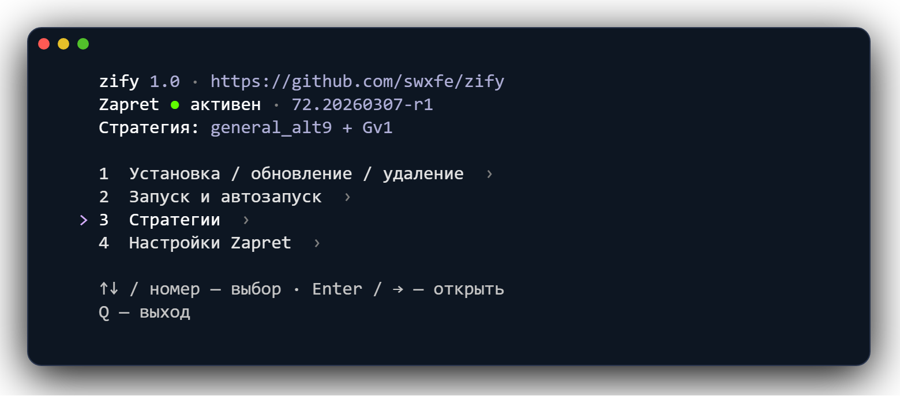

<div align="center">


**Zapret на OpenWrt — всё в одном меню.**

Установка, стратегии и настройки через SSH.

[Установка](docs/install.md) · [CLI](docs/cli.md) · [Тесты](docs/tests.md)



</div>

## Установка

Подключитесь к роутеру по SSH от `root` и выполните:

```sh
wget -O /tmp/zify-install.sh https://raw.githubusercontent.com/swxfe/zify/main/tools/bootstrap.sh && sh /tmp/zify-install.sh
```

Нужны интернет и свободное место. Установщик проверит зависимости, предложит установить недостающие пакеты и откроет меню.

Выберите **«Установка / обновление / удаление» → «Установить Zapret»**. Для повторного запуска:

```sh
zify
```

## Возможности

| Раздел | Что умеет |
| --- | --- |
| **Стратегии** | Готовые пресеты Flowseal и Zapret Manager или сборка групп для основного трафика, YouTube и Discord. Игровые стратегии добавляются отдельно. |
| **Фейки** | Просмотр и замена файлов в текущей стратегии. |
| **Сервис** | Запуск, остановка, перезапуск и автозапуск Zapret. |
| **Настройки** | IPv6, QUIC, исключения устройств и Flow Offloading. |

Стратегии, фейки и списки хранятся на роутере — для выбора интернет не нужен. Рабочая стратегия зависит от провайдера.

## Обновление и удаление

zify проверяет обновления при запуске. Код, стратегии и фейки обновляются вместе. Обновление менеджера и пакетов, а также выборочное удаление доступны в разделе **«Установка / обновление / удаление»**.

При ошибке применения настроек zify возвращает прежнюю конфигурацию. Установка и удаление системных пакетов в этот откат не входят.

## Благодарности

- [bol-van/zapret](https://github.com/bol-van/zapret) — сам Zapret.
- [remittor/zapret-openwrt](https://github.com/remittor/zapret-openwrt) — пакеты Zapret и LuCI для OpenWrt.
- [Flowseal/zapret-discord-youtube](https://github.com/Flowseal/zapret-discord-youtube) — пресеты, фейки и списки под [MIT](licenses/MIT.txt).
- [StressOzz/Zapret-Manager](https://github.com/StressOzz/Zapret-Manager) — стратегии под [Apache-2.0](licenses/Apache-2.0.txt). Авторство и изменения — в [NOTICE](NOTICE).

Код zify — [AGPL-3.0](LICENSE).
